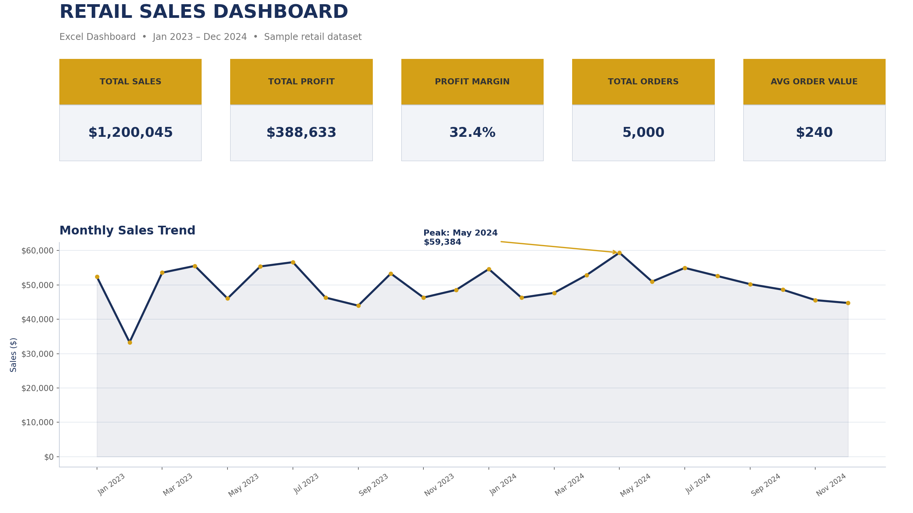
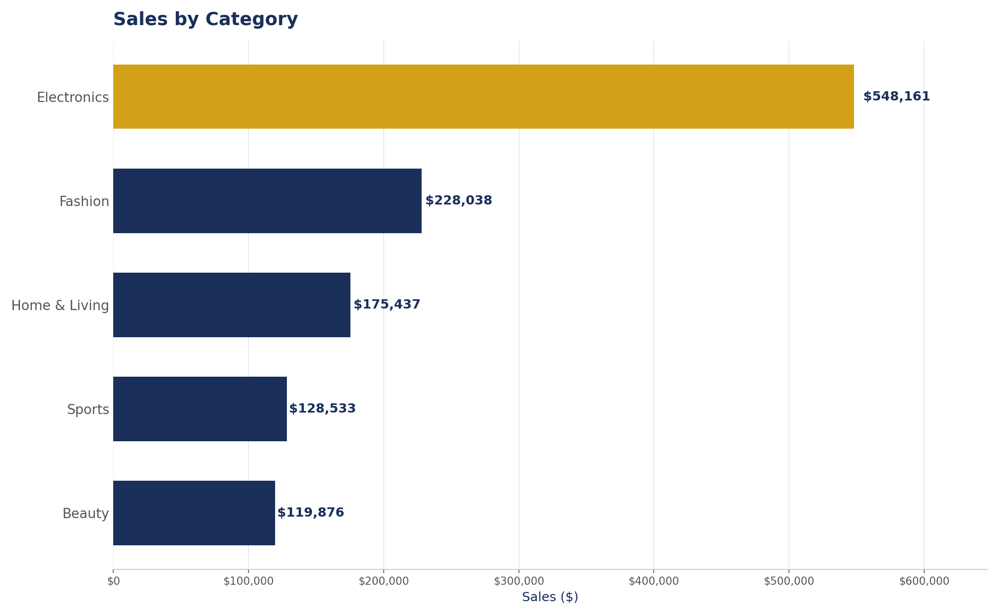

# Retail Sales Dashboard — Excel

Sales Dashboard in Excel — KPI cards (total sales, profit, margin, orders), 3 charts (monthly trend, sales by category, sales by region) fed by a summary layer, built from a cleaned retail dataset of 5,000 orders.

## Overview

A complete, client-ready sales dashboard built in Microsoft Excel (generated with openpyxl for precision). It turns a raw 5,000-row retail dataset into a one-page dashboard with KPI cards and trend/segment charts that update from structured summary tables.

> **Note:** the data is synthetic/sample data (generated for practice), covering Jan 2023 – Dec 2024 across 5 product categories and 5 regions. All numbers below are real computations from that dataset.

## Tools used

- **Microsoft Excel** — dashboard layout, KPI cards, number formatting, print-ready design
- **Excel formulas & summary tables** — the same results you'd get with SUMIFS + PivotTables (automated here for reproducibility)
- **Power Query concepts** — dedup, date parsing, type cleaning before loading
- **Native Excel charts** — line chart, bar chart, pie chart fed by summary tables
- **Python (pandas / openpyxl / matplotlib)** — build pipeline only; everything in the `.xlsx` is native Excel

## Key insights (from the actual data)

- **$1,200,045 total sales** across 5,000 orders (2023: $591,390 → 2024: $608,655, up ~3% year over year), with **$388,633 profit at a 32.4% margin**.
- **Electronics is the engine:** $548,161 in sales — **45.7% of all revenue**. Fashion ($228,038) and Home & Living ($175,437) are far behind. Any growth strategy starts with Electronics.
- **Margins are uniform (~32.2–32.7%) across all categories**, so profitability is a *volume* game here — discount deeper on slow movers (Sports, Beauty) without fearing margin collapse.
- **Best month: May 2024 ($59,384); worst: Feb 2023 ($33,317).** A clear seasonal dip early each year — plan promotions for Q1.
- **Online channel wins:** 49.2% of sales vs. 30.7% Retail Store and 20.2% Marketplace — invest in the online storefront first.
- **Best-selling product: Webcam ($114,496)** — within Electronics, peripherals outperform.
- **South region leads** with $244,790 (20.4%), but sales are spread evenly across all five regions — no single-region risk.

## File guide

| File | What it is |
|---|---|
| `Retail_Sales_Dashboard.xlsx` | The deliverable. `Dashboard` sheet = KPI cards + 3 native charts; `Summary` sheet = monthly / category / region tables feeding the charts; `Data` sheet = the full cleaned 5,000-row dataset (filterable) |
| `screenshots/` | Client-ready PNG exports of the dashboard and charts |
| `build_dashboard.py` | Reproducible build script (data cleaning → KPIs → xlsx + screenshots) |
| `README.md` | This file |

**To use:** open `Retail_Sales_Dashboard.xlsx` in Excel — the Dashboard sheet is print-ready. Update the `Summary` tables and the charts + KPI cards refresh from them.

## Skills demonstrated

- Data cleaning (deduplication, date/type normalization)
- KPI design (sales, profit, margin %, orders, average order value)
- Summary-table modeling (monthly, category, region aggregates)
- Native Excel chart building (line, column, pie)
- Business storytelling — turning numbers into concrete recommendations
- Reproducible pipeline (pandas + openpyxl) so the dashboard can be rebuilt on new data
